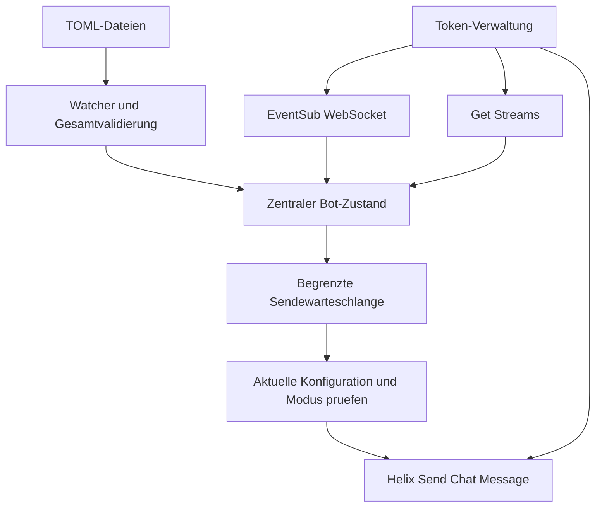
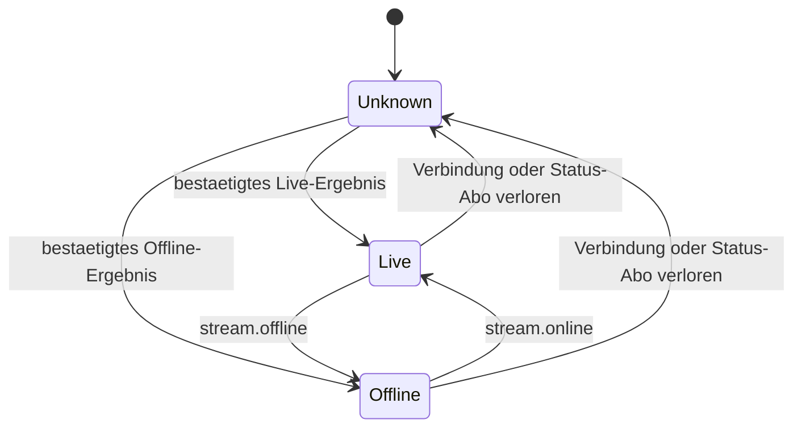
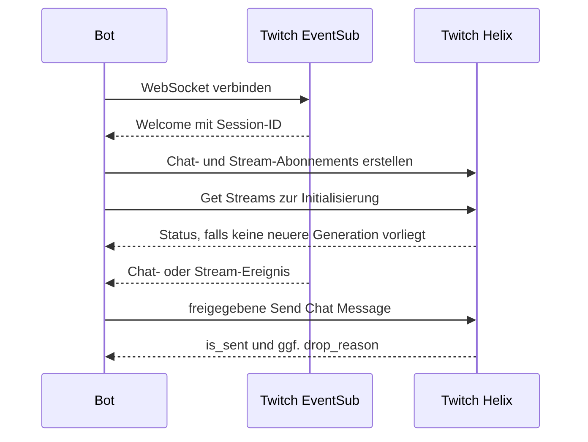
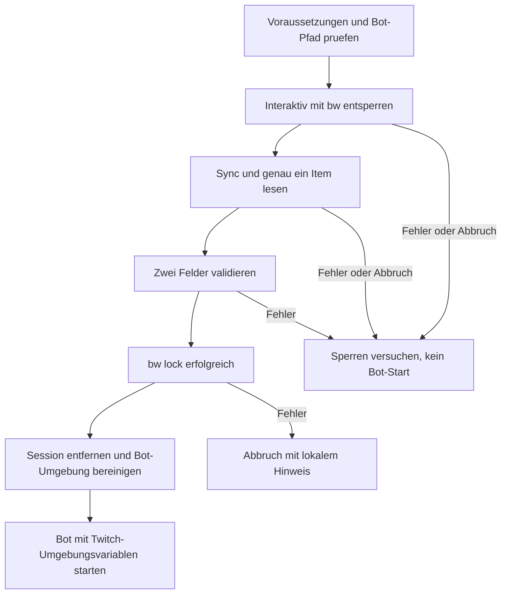

# Mad Super Bot - Plan

## Goal Capsule

- **Objective:** Zuschauer erhalten im Twitch-Chat die aktuellen Projekt- und Social-Informationen; der Streamer pflegt Antworten und automatische Hinweise durch Speichern seiner TOML-Dateien.
- **Means:** Eigenständiger Rust-Dienst mit Twitch EventSub und Helix, gemäß KTD1.
- **Authority:** Product Contract bestimmt das Verhalten; Planning Contract bestimmt die Umsetzung; Implementation Units dürfen keines von beiden erweitern.
- **Execution profile:** Ein zusammenhängender Lieferumfang mit sieben Umsetzungseinheiten; der Bitwarden-Startweg ist optional. Zielprojekt ist `mad-super-bot`, unabhängig von Madlink. Derzeit existieren dort nur zwei TOML-Dateien und `BACKLOG.md`, noch kein Rust-Projekt oder Git-Repository.
- **Boundaries:** Dieser Auftrag erstellt ausschließlich den Plan. Eine spätere Umsetzung umfasst lokale Verifikation; Veröffentlichung, Deployment und echte Chatnachrichten benötigen einen entsprechenden Ausführungsauftrag.
- **Stop conditions:** Fehlende Twitch-Zugangsdaten blockieren nur den Live-Nachweis. Abweichungen von bestätigten Produktentscheidungen werden vor Umsetzung geklärt. Secrets gehören weder in den Plan noch in Logs oder Versionskontrolle.

---

## Product Contract

### Summary

Ein Bot bedient einen Twitch-Kanal mit statischen Commands und zeitgesteuerten Nachrichten. Die vorhandenen TOML-Strukturen bleiben maßgeblich. Änderungen werden während des Betriebs übernommen; die manuelle Blacklist und ein nutzerweiter Cooldown begrenzen Command-Antworten. Ein globaler Loop-Modus erlaubt Betrieb unabhängig vom Stream oder ausschließlich während bestätigter Live-Phasen.

### Problem Frame

Projektbeschreibungen und Social-Links sollen im Stream abrufbar sein, ohne dass der Streamer sie wiederholt selbst eingibt. Die Texte müssen sich während des Streams unkompliziert ändern lassen.

### Key Decisions

- **Dateien als Bedienoberfläche.** Governs R1, R5. (session-settled: user-directed — chosen over Chat-Administration oder Bedienoberfläche: vorhandene TOML-Dateien sollen die Inhalte bestimmen.)
- **Konfigurierbarer Loop-Betrieb.** Governs R7. (session-settled: user-directed — chosen over ausschließlich Live-Betrieb: beide Modi sollen auswählbar sein.)
- **Gemeinsamer Nutzer-Cooldown.** Governs R3. (session-settled: user-approved — chosen over separate Wartezeiten je Command: Aliase und Command-Wechsel sollen die Wartezeit nicht umgehen.)

### Requirements

**Commands**

- R1. `static_commands.toml` behält `[config]` und `[commands.<name>]` mit `alias` und `message`; die vorhandenen Texte, Links und Command-Namen bleiben erhalten.
- R2. Das erste durch Leerraum getrennte Wort einer Nachricht wird nach Entfernen führenden Leerraums exakt gegen Präfix plus Command oder Alias geprüft, ohne Beachtung der ASCII-Großschreibung. Weitere Wörter sind erlaubt und werden ignoriert; unbekannte Commands und eigene Bot-Nachrichten lösen keine Antwort aus.
- R3. `config.user_cooldown` ist eine nichtnegative ganzzahlige Sekundenanzahl, aktuell `17`; pro Twitch-Nutzer gilt sie gemeinsam für alle Commands und Aliase. Abgelaufene Einträge dürfen entfernt werden; `0` deaktiviert den Cooldown. Abgewiesene Nachrichten verlängern ihn nicht.
- R4. `config.blacklist` enthält Twitch-Loginnamen, die unabhängig von Großschreibung von Command-Antworten ausgeschlossen sind. Diese Sperre ist nur eine Bot-Sperre, kein Kanalban; unbekannte Commands und gesperrte Nutzer erhalten keine Fehlermeldung im Chat.

**Konfiguration und Loops**

- R5. Speichern einer der beiden TOML-Dateien lädt eine konsistente, validierte Konfiguration ohne Neustart; ungültige Änderungen lassen die letzte gültige Fassung aktiv und erzeugen einen verständlichen lokalen Fehler. Ist die Startkonfiguration ungültig, startet der Bot keine Netzwerkaktivität.
- R6. Jede benannte Loop-Tabelle definiert ein positives, endliches `interval` in Minuten sowie genau eines von `message` oder `command`. Ganzzahlen und Dezimalwerte sind zulässig; `0.5` bedeutet 30 Sekunden. `command` verweist auf einen kanonischen Command-Namen ohne Präfix, nicht auf einen Alias.
- R7. Ein globales `config.mode` unter `[config]` in `loop.toml` erlaubt ausschließlich `"always-on"` oder `"live-only"`. Fehlendes `config.mode` bedeutet `"live-only"`; es steuert nur Loops. Statische Commands bleiben in beiden Modi auch offline verfügbar.
- R8. Jeder Loop sendet erstmals nach einem vollständigen Intervall ab Betriebsbereitschaft beziehungsweise bestätigtem Übergang in eine Live-Phase. `live-only` pausiert bei offline oder unbekanntem Status; beim nächsten Live-Beginn startet das volle Intervall neu. `always-on` benötigt keinen Live-Status.
- R9. Reine Textänderungen erhalten vorhandene Timer; neue Loops, geänderte Intervalle oder ein geänderter Modus starten ihre betroffenen Timer neu. Entfernte Loops werden beendet. Verknüpfte Loops verwenden bei der Sendefreigabe den aktuellen Command-Text.
- R10. Verpasste Loop-Termine werden nicht als Nachrichtenserie nachgeholt. Pro Loop darf höchstens ein ausstehender Sendewunsch existieren; nach erfolgreichem oder endgültig abgebrochenem Versuch beginnt sein nächstes volles Intervall.

**Betrieb**

- R11. Commands und Loops beachten gemeinsam die Twitch-Sendelimits. Fehlgeschlagene, abgelehnte oder verworfene Sendungen werden lokal sichtbar; HTTP-Erfolg allein gilt nicht als erfolgreiche Chatnachricht.
- R12. Der Bot erneuert Zugangstokens und stellt die EventSub-Verbindung nach Ausfällen wieder her. Unklare Sendebestätigungen werden nicht automatisch wiederholt, damit ein verlorener HTTP-Response keine doppelte Nachricht verursacht.
- R13. Die Blacklist bleibt manuell gepflegt. Automatischer Spam-Schutz bleibt ausschließlich als späterer Umfang in `BACKLOG.md`.

**Optionaler Bitwarden-Start**

- R14. Der integrierte Startweg `mad-super-bot --bitwarden` (Alias `-bw`) verwendet die vorausgesetzte `bw` CLI und liest Item-ID und Namen der beiden benutzerdefinierten Felder aus `bitwarden_wrapper.toml` über `item_id`, `client_id_field` und `client_secret_field`. Die Beispielkonfiguration verwendet Item `1beb84d5-a33c-48b2-ba13-1e8eb44654a5` mit den Feldnamen `client_id` und `client_secret`; diese Werte sind nicht im Programm fest codiert. Der direkte Bot-Start mit Umgebungsvariablen bleibt ohne Bitwarden möglich.
- R15. Der Wrapper entsperrt interaktiv, lädt und validiert beide Werte, sperrt den CLI-Vault und startet erst nach erfolgreichem Sperren den Bot. Fehlende, leere oder mehrdeutige Felder, fehlgeschlagene Vault-Zugriffe und fehlgeschlagenes Sperren verhindern den Bot-Start.
- R16. Der Bot erhält die beiden Twitch-Werte als `TWITCH_CLIENT_ID` und `TWITCH_CLIENT_SECRET`, aber niemals `BW_SESSION`. Masterpasswort, Session-Schlüssel und vollständiges Item-JSON werden weder in Dateien geschrieben noch als Prozessargumente oder Logausgaben weitergegeben.

### Acceptance Examples

- AE1. Covers R2, R3: Ein Nutzer löst `!insta` aus; `!project` nach 16 Sekunden bleibt ohne Antwort, nach 17 Sekunden darf es antworten. Ein anderer Nutzer wartet nicht auf diesen Cooldown.
- AE2. Covers R4, R5: Nach Speichern eines neuen Blacklist-Eintrags bekommt dieser Nutzer auf den nächsten Command keine Antwort; ein Syntaxfehler in der Datei ersetzt die aktive Konfiguration nicht.
- AE3. Covers R6, R8: Ein Loop mit `interval = 0.5` sendet nicht sofort beim Start, sondern nach 30 Sekunden zulässiger Betriebszeit.
- AE4. Covers R7, R8: Bei `live-only` verhindert unbekannter Status jede Loop-Sendung; bei `always-on` kann derselbe Loop offline senden.
- AE5. Covers R5, R9: Eine gültige Änderung von `commands.socials.message` verändert den nächsten `socials`-Loop-Text, ohne dessen Intervall neu zu starten.

- AE6. Covers R14–R16: Ein erfolgreicher Wrapper-Aufruf führt Entsperren, Item-Lesen, Sperren und Bot-Start in dieser Reihenfolge aus; der Bot sieht beide Twitch-Werte und keine Vault-Session, auch wenn die aufrufende Shell bereits `BW_SESSION` gesetzt hatte.
- AE7. Covers R15: Fehlt das konfigurierte Client-Secret-Feld oder schlägt das Sperren fehl, startet kein Bot; nach einem Fehler während des geöffneten Vaults wird die Sperrung dennoch versucht.

### Scope Boundaries

Kein Dashboard, keine Chat-Admincommands, keine Datenbank, keine KI-generierten Texte, kein Mehrkanalbetrieb und keine automatische Moderation. Automatischer Spam-Schutz steht bereits in `BACKLOG.md`; die Unterscheidung zwischen Bot-Sperre, Timeout und Kanalban bleibt diesem späteren Vorhaben vorbehalten.

Persistente Cooldowns, eine dauerhafte Nachrichtenwarteschlange und genau-einmalige Zustellung werden nicht gebaut: Nach Neustart beginnt der flüchtige Zustand neu; alte Hinweise nachträglich zu senden würde den Chat eher stören. Ein Bedarf an garantierter Nachrichtenhistorie wäre ein neuer Auftrag.

---

## Planning Contract

### Assumptions

- Der vorhandene Modus unter `[config]` gilt global für alle Loops; unterschiedliche Modi pro Loop sind nicht Bestandteil dieses Plans.
- Ein Bot-Prozess und ein Twitch-Account bedienen einen Zielkanal. Dieser Bot-Prozess ist der einzige automatisierte Sender dieses Accounts.
- Die erste Zielplattform ist lokales Linux. Ein Dienstmanager oder Container-Deployment gehört nicht zur ersten Umsetzung.
- Der erste Live-Nachweis nutzt einen vom Betreiber benannten Kanal und freigegebene Testtexte; der Plan selbst autorisiert keine Nachrichten.

### Key Technical Decisions

- KTD1. **Rust mit Tokio und `twitch_api`.** Ausgangspunkt ist die dokumentierte `twitch_api`-Version 0.8.0 mit gezielten Features für Helix, EventSub, HTTP und OAuth. Dazu `twitch_oauth2`, `reqwest`, ein Tokio-WebSocket-Client, `serde`, `toml`, `notify` und `tracing`; kompatible Versionen werden bei Projektanlage aufgelöst und über `Cargo.lock` festgehalten. Rust ist nach dem Sprachvergleich akzeptiert; ein neues SDK wird nicht gebaut. [Library-Dokumentation](https://docs.rs/twitch_api/0.8.0/twitch_api/)
- KTD2. **Validierter Snapshot statt Dateizugriff pro Chatnachricht.** Eine zentrale Konfigurationsinstanz liest beide Dateien zusammen und tauscht den Snapshot erst nach erfolgreicher Gesamtvalidierung. Verzeichnisüberwachung mit kurzem Debounce, etwa 200 ms, erfasst auch atomisches Ersetzen durch Editoren; beim erneuten Dateiereignis wird erneut gelesen. Command-/Alias-Kollisionen, ungültige Präfixe, leere Texte, Nachrichten über 500 Zeichen, fehlende Verweisziele und unbekannte Felder werden abgewiesen. Namen und Aliase sind nichtleere ASCII-Tokens ohne Leerraum oder Präfix; `config` ist für Einstellungen reserviert und darf kein Loop sein. [notify: Editor-Verhalten](https://docs.rs/notify/latest/notify/)
- KTD3. **Ein Besitzer für den Laufzeitzustand.** Ein Tokio-Ereignisloop hält Cooldowns, Timer, Konfigurationsgeneration und ausstehende Sendewünsche. Cooldowns sind nach Twitch-User-ID indiziert und beginnen atomar mit Annahme eines Sendewunschs; Fehler bei dessen späterer Zustellung setzen sie nicht zurück. Konfigurationswechsel erhalten die Zeitstempel und wenden den aktuellen Cooldown-Wert an. Nachrichten werden nicht als unkontrollierte parallele Tasks abgearbeitet.
- KTD4. **Getrennter OAuth-Zustand.** Ein expliziter CLI-Authentifizierungsschritt nutzt den Device Code Flow für die vorhandene vertrauliche Twitch-App und fordert `user:read:chat` sowie `user:write:chat` an. Der Betreiber öffnet die ausgegebene Twitch-Verifikationsadresse und autorisiert den gewünschten Bot-Account; Polling beachtet Twitch-Intervall, Verlangsamung und Ablaufzeit. Client-ID, Client-Secret und Zielkanal kommen aus Umgebungsvariablen; Tokens liegen in einer separaten Datei mit Linux-Modus `0600` und niemals in den Content-TOMLs. Token-Client-ID und Scopes werden validiert, die Bot-ID wird aus dem validierten Token abgeleitet und der Zielkanal separat aufgelöst. Refresh erfolgt zentral und speichert rotierte Tokens atomar. Validierung erfolgt beim Start und mindestens stündlich; fehlende Freigabe stoppt den Betrieb mit einer handlungsfähigen Meldung. [Device Code Flow](https://dev.twitch.tv/docs/authentication/getting-tokens-oauth/#device-code-grant-flow), [Twitch-Validierung](https://dev.twitch.tv/docs/authentication/validate-tokens/)
- KTD5. **EventSub als Eingang, Helix als Ausgang.** `channel.chat.message` liefert Commands. Wiederholte EventSub-Message-IDs werden über einen zeitlich und mengenmäßig begrenzten Cache ignoriert; der Cache bleibt beim Reconnect erhalten. Ein Twitch-angeordneter Session-Reconnect übernimmt bestehende Abonnements, ein harter Verbindungsabbruch erfordert neue Abonnements. Keepalive-Timeout und Widerruf werden explizit behandelt. [WebSocket-Protokoll](https://dev.twitch.tv/docs/eventsub/handling-websocket-events/)
- KTD6. **Live-Status ist ein eigener Zustand.** Nach Installation von `stream.online`/`stream.offline` erfolgt `Get Streams` zur Initialisierung und nach jeder harten Neuverbindung. Während einer Abfrage eintreffende Stream-Ereignisse haben Vorrang vor einem veralteten Abfrageergebnis; eine Statusgeneration verhindert Überschreiben. Verbindungsverlust oder Status-Widerruf setzt den Zustand auf unbekannt. Fehlgeschlagene Statusabfragen werden mit begrenztem Backoff erneut versucht. Erst ein gültiges Ereignis oder eine erfolgreiche Abfrage gibt `live-only` frei. Es gibt keine Replay-Garantie für ausgefallene Sitzungen. [EventSub-Typen](https://dev.twitch.tv/docs/eventsub/eventsub-subscription-types/), [Get Streams](https://dev.twitch.tv/docs/api/reference/#get-streams)
- KTD7. **Eine begrenzte Sendewarteschlange.** Commands und Loops durchlaufen denselben Sender. Eine FIFO mit maximal 64 Einträgen und 30 Sekunden Gültigkeit pro Eintrag verhindert unbegrenzten Rückstau; volle oder abgelaufene Einträge werden protokolliert verworfen. Direkt vor Versand werden Blacklist, Existenz des Commands/Loops, aktuelle Texte und Loop-Modus erneut geprüft. Live-only-Aufträge gehören zu einer Live-Phase und werden nach deren Ende nicht in eine spätere Phase übernommen. Twitch-Limits gelten konservativ für einen normalen Bot-Account, einschließlich Kanalabstand; zusätzliche HTTP-Limits und `429` werden ebenfalls beachtet. [Twitch-Sendelimits](https://dev.twitch.tv/docs/chat/#rate-limits)
- KTD8. **Sendestatus statt pauschaler Retries.** `is_sent` und `drop_reason` aus der Send Chat Message Response bestimmen Erfolg beziehungsweise Ablehnung. Ein sicher abgewiesener `429`-Request darf innerhalb seiner Restgültigkeit nach Limit-Freigabe erneut versucht werden; ein sicherer `401` höchstens einmal nach Token-Erneuerung. Timeouts, Verbindungsabbrüche nach Request-Beginn und unklare Serverfehler erzeugen keine blinden Retries. [Send Chat Message](https://dev.twitch.tv/docs/api/reference/#send-chat-message)

- KTD9. **Optionaler Bitwarden-Start im Hauptbinary.** Das Hauptbinary kapselt hinter `--bitwarden` (Alias `-bw`) `bw`-Subprozesse und JSON-Auswertung. Damit werden weder `jq` noch ein Shell-Skript mit Secret-Expansion benötigt. `bw` muss bereits installiert, für den gewünschten Bitwarden-Server konfiguriert und angemeldet sein; der Wrapper ändert weder Server noch Login. Fehlende Voraussetzungen werden vor dem Entsperren gemeldet. Die konkrete Kombination aus Bitwarden und installierter CLI wird erst bei der Umsetzung geprüft. Die Wrapper-Konfiguration wird einmal je Aufruf vor dem Entsperren eingelesen; Änderungen wirken beim nächsten Start, ohne Hot-Reload oder Eingriff in einen laufenden Bot. Alle drei Schlüssel sind erforderliche, nichtleere Strings; die beiden Feldnamen müssen verschieden sein. Fehlende Datei, ungültiges TOML oder unbekannte Schlüssel führen zum Abbruch vor Vault-Zugriff, ohne Rückfall auf fest codierte Werte. Die Datei enthält ausschließlich Referenzen und Feldnamen, keine Secret-Werte. Governs R14–R16.
- KTD10. **Session nur in den benötigten CLI-Kindprozessen.** Der Wrapper ignoriert geerbte `BW_SESSION`- und Passwort-Automatisierungsvariablen für den interaktiven Start. `bw unlock --raw` erhält Terminal-Eingabe; sein Session-Ergebnis wird über eine Pipe ausschließlich im Speicher erfasst. Der frisch erhaltene Schlüssel wird nur als `BW_SESSION` der benötigten `bw`-Kindprozesse gesetzt, nicht in die globale Wrapper-Umgebung und nicht über `--session` in deren Argumentliste. Nach Entsperren synchronisiert der Wrapper den Vault und liest genau das Item aus R14. Die beiden Felder müssen jeweils einmal als nichtleere Zeichenkette vorhanden sein; sie werden als Daten verarbeitet, niemals als Shell-Ausdruck. [Bitwarden CLI: unlock, get, sync und lock](https://bitwarden.com/help/cli/)
- KTD11. **Sperren als verbindliche Startbedingung.** Nach jedem Entsperrversuch ist ein Aufräumpfad für Fehler und behandelbare Abbruchsignale eingerichtet. Nach erfolgreichem Lesen muss `bw lock` erfolgreich enden, bevor der Wrapper den Bot-Prozess ersetzt. Anschließend werden Item- und Session-Puffer verworfen und die Bot-Umgebung explizit von `BW_*` sowie `BITWARDENCLI_APPDATA_DIR` bereinigt; vorhandene Twitch-Werte werden durch die gelesenen Werte ersetzt. Dasselbe Hauptbinary wird ohne Shell mit den gewählten Bot-Optionen und dem Unterbefehl, aber ohne Bitwarden-Flag neu gestartet. Ein Startfehler lässt den Vault gesperrt. Nicht abfangbare Prozessabbrüche oder Stromausfall können keine Aufräumgarantie erhalten; bei fehlgeschlagener Sperrung meldet der Wrapper ausschließlich den nötigen manuellen Sperrschritt. Sperren betrifft das verwendete CLI-Profil, nicht automatisch andere Bitwarden-Clients. Die Twitch-Secrets bleiben für den laufenden Bot zugänglich, damit dessen Token-Refresh weiter funktioniert. Governs R15, R16.

### High-Level Technical Design







Der folgende Ausschnitt entspricht der vorhandenen Konfigurationsoberfläche; sie ist keine Änderung an den Nutzerdateien in diesem Planungsauftrag:

```toml
[config]
mode = "live-only" # oder "always-on"
```

| Zustand | always-on | live-only |
|---|---|---|
| Start, Status unbekannt | Timer nach Betriebsbereitschaft | Warten auf Live-Bestaetigung |
| Live | Timer aktiv | Timer aktiv |
| Offline | Timer aktiv | Timer aus |
| Statusverbindung verloren | Weiter, sofern Senden moeglich | Timer aus, alte Auftraege verwerfen |
| Modus geaendert | Volles Intervall neu | Status pruefen, dann volles Intervall |

Konfigurationsoberfläche des optionalen Wrappers gemäß R14 und KTD9, als `bitwarden_wrapper.toml` im Projektverzeichnis:

```toml
item_id = "1beb84d5-a33c-48b2-ba13-1e8eb44654a5"
client_id_field = "client_id"
client_secret_field = "client_secret"
```

Der Wrapper erhält einen eigenen Konfigurationspfad-Parameter; ohne Angabe verwendet er `bitwarden_wrapper.toml` im aktuellen Arbeitsverzeichnis. Dieser Parameter wird vom Wrapper verarbeitet und nicht als Bot-Argument weitergereicht. Feldnamen werden exakt gegen die benutzerdefinierten Item-Felder verglichen; die Zielvariablen des Bots bleiben gemäß R16 unverändert.

Optionaler Startablauf gemäß KTD9–KTD11:



### Existing Sources and Constraints

`static_commands.toml` enthält bereits `project`, `socials`, `instagram`, `tiktok`, `youtube`, `discord`, deren Aliase, die Blacklist und `user_cooldown = 17`. `loop.toml` enthält bereits `[config]` mit `mode = "live-only"`, außerdem `discord` als eigenen Text alle 30 Minuten und `socials` als Command-Verweis alle 60 Minuten. Diese Dateien sind die bestehenden Muster; es gibt keine bestehende Anwendung, Tests oder Build-Konventionen zu übernehmen. `BACKLOG.md` bleibt der Ort für den späteren Spam-Schutz.

OAuth-Freigabe, tatsächliche App-Konfiguration und Netzwerkzugang werden bei Umsetzung geprüft, ohne Secrets in Ausgaben zu übernehmen. Die benötigten Chat- und Stream-Funktionen sind dokumentiert; ein erfolgreicher Rust-Build und Twitch-Livebetrieb sind noch nicht nachgewiesen.

---

## Implementation Units

### U1. Rust-Projekt und Konfigurationsvertrag

**Goal:** Die vorhandenen Dateien werden typsicher geladen und als gültiger Gesamtsnapshot bereitgestellt.

**Requirements:** R1, R5–R7; KTD1, KTD2.

**Dependencies:** Keine.

**Files:** Neu `Cargo.toml`, `Cargo.lock`, `src/lib.rs`, `src/main.rs`, `src/config.rs`, `tests/config.rs`, `.gitignore`; die vorhandenen `static_commands.toml` und `loop.toml` bleiben unverändert.

**Approach:** Konfigurationsmodell, Validierung und aufgelöste Alias-/Loop-Indizes in einem Modul halten. CLI-Konfigurationspfad und Token-Dateipfad werden explizit auflösbar; keine Abhängigkeit vom Aufrufverzeichnis für spätere Reloads. Ein lokaler Konfigurationscheck bleibt ohne Twitch-Zugriff nutzbar.

**Patterns:** Die vorhandenen beiden TOML-Dateien und KTD2 bestimmen das Format.

**Test scenarios:**

1. Vorhandene Dateien einschließlich aller Texte und Aliase werden unverändert geladen.
2. Ganzzahliges `30` und dezimales `0.5` liefern korrekte Dauern; Null, negative, nichtendliche und nicht darstellbare Intervalle scheitern.
3. Beide Payload-Felder, keines der Felder, ein fehlender Command-Verweis und eine Alias-Kollision scheitern mit Fundstelle.
4. Fehlender Modus ergibt `live-only`; beide erlaubten Werte funktionieren, Tippfehler scheitern.
5. Überlange oder leere Nachrichten, ungültiger Cooldown und unbekannte Felder scheitern vor Netzwerkzugriff.

**Verification:** `tests/config.rs` prüft die reine Konfigurationsgrenze, nicht die späteren Dateisystemereignisse.

### U2. Twitch-Authentifizierung und Transport

**Goal:** Autorisiert Chatereignisse empfangen und Nachrichten senden können.

**Requirements:** R11, R12; KTD1, KTD4, KTD5, KTD8.

**Dependencies:** U1.

**Files:** Neu `src/auth.rs`, `src/twitch.rs`, `tests/auth.rs`, `tests/twitch_transport.rs`; Erweiterung `src/main.rs`, `.gitignore`.

**Approach:** HTTP und WebSocket hinter kleinen, testbaren Grenzen kapseln. Token-Lifecycle und CLI-Authentifizierung gemäß KTD4 zentralisieren, getrennte HTTP- und EventSub-Fehler behandeln. Der verwendete User-Token darf beim Senden nicht mit dem App-Token-exklusiven Feld `for_source_only` kombiniert werden; Twitch Shared Chat kann die Sichtbarkeit gesendeter Nachrichten erweitern und wird für die erste Live-Abnahme deaktiviert.

**Patterns:** Offizielles EventSub-WebSocket-Protokoll und `twitch_api`-Beispiele; kein IRC-Fallback.

**Test scenarios:**

1. Falsche Client-ID, fehlende Chat-Scopes oder falsche Token-Identität verhindern Betriebsbereitschaft.
2. Gleichzeitiger Erneuerungsbedarf führt zu einer Token-Erneuerung; rotierter Refresh-Token wird gespeichert.
3. Welcome, Keepalive, angeordneter Session-Wechsel und harter Abbruch erzeugen die jeweils richtigen Subscription-Aktionen.
4. Doppelte Event-ID wird einmal verarbeitet; unbekannte Ereignistypen werden ignoriert.
5. Erfolgreicher HTTP-Response mit `is_sent = false` gilt als Ablehnung; unklare Sendetimeouts werden nicht wiederholt.
6. Device-Code-Polling behandelt ausstehende Zustimmung, Verlangsamung, Ablehnung und Ablauf; die erfolgreiche Freigabe speichert nur Tokens mit den erforderlichen Scopes.

**Verification:** Lokale HTTP-/WebSocket-Doubles beweisen Protokollverhalten und Token-Persistenz, nicht die Akzeptanz tatsächlicher Twitch-Zugangsdaten.

### U3. Command-Verarbeitung und zentraler Sender

**Goal:** Commands, Blacklist, Cooldown und Sendelimits arbeiten gemeinsam korrekt.

**Requirements:** R2–R4, R11, R12; KTD3, KTD7, KTD8.

**Dependencies:** U1, U2.

**Files:** Neu `src/commands.rs`, `src/outbound.rs`, `tests/commands.rs`, `tests/outbound.rs`.

**Approach:** Eingehende Nachrichten gegen den aktiven Snapshot auswerten; Sendewünsche tragen Quelle, Nutzer-ID und Ablaufzeit statt einer unkontrollierten Textkopie. U3 erzeugt die gemeinsame Queue auch für spätere Loops. Zustände und Uhr sind für Tests kontrollierbar.

**Patterns:** KTD3 und KTD7; keine Twitch-Aufrufe in der reinen Command-Auswertung.

**Test scenarios:**

1. Covers AE1: Alias, Command-Wechsel, Grenze bei 17 Sekunden und unabhängiger zweiter Nutzer.
2. Großschreibung, führender Leerraum, zusätzliche Wörter und exakte Token-Grenze funktionieren gemäß R2.
3. Blacklist und eigener Bot-Nutzer lösen keinen Sendewunsch aus; abgewiesene Commands verlängern keine Wartezeit.
4. Ein Burst mehrerer Nutzer und Loops überschreitet weder Queue-Grenze noch simulierte Twitch-Limits.
5. Abgelaufene, inzwischen gesperrte oder nicht mehr existierende Command-Aufträge werden vor Versand verworfen.
6. `429`, `401`, `is_sent = false` und unklarer Request-Ausgang folgen KTD8.

**Verification:** Deterministische Tests beweisen Auswahl und Reihenfolge; Twitch-eigene Moderationsfilter bleiben Teil des Live-Nachweises.

### U4. Loop-Scheduler und Live-Status

**Goal:** Periodische Hinweise entsprechen Modus und aktuellen Stream-Phasen.

**Requirements:** R6–R10; KTD3, KTD6, KTD7.

**Dependencies:** U1–U3.

**Files:** Neu `src/scheduler.rs`, `src/live_status.rs`, `tests/scheduler.rs`, `tests/live_status.rs`.

**Approach:** Scheduler mit monotonen Deadlines und kontrollierbarer Uhr bauen. Live-Status und Live-Phasen-ID getrennt vom Verbindungsstatus führen; vor Freigabe aus der gemeinsamen Queue erneut prüfen.

**Patterns:** Zustandsdiagramm und KTD6; keine periodischen Tasks pro Konfigurationsneuladung stehen lassen.

**Test scenarios:**

1. Covers AE3, AE4: Kein sofortiger Starttick; 30-Sekunden-Intervall, offline und unbekannt unterscheiden beide Modi.
2. Stream-Ende verwirft ausstehende Live-only-Sendungen; ein neuer Stream beginnt ohne Nachholen.
3. Ein während Get Streams eintreffendes neueres Ereignis wird nicht von dessen älterer Antwort überschrieben.
4. Harter Disconnect sperrt Live-only-Loops, erfolgreiche Reinitialisierung gibt sie nach vollem Intervall frei.
5. Modus- und Intervalländerung starten Timer neu; Textänderung erhält Deadlines; entfernte Loops verschwinden.
6. Nach langer Sendesperre entsteht keine Tick-Serie und höchstens ein wartender Auftrag je Loop.

**Verification:** Pausierte Tokio-Zeit und Stream-Fixtures beweisen Übergänge ohne reale Wartezeiten; sie beweisen nicht die Zustellgeschwindigkeit von Twitch-Ereignissen.

### U5. Reload und Prozessintegration

**Goal:** Ein laufender Prozess übernimmt gespeicherte Änderungen konsistent.

**Requirements:** R5, R9, R12, R13; KTD2–KTD7.

**Dependencies:** U1–U4.

**Files:** Neu `src/reload.rs`, `src/runtime.rs`, `tests/reload.rs`, `tests/runtime.rs`; Erweiterung `src/main.rs`.

**Approach:** Watcher, Twitch-Eingang, Status und Scheduler an den zentralen Zustand anbinden. Nur die zwei Zielpfade lösen Reload aus; neue Generationen ersetzen gemeinsam die Konfiguration. SIGINT/SIGTERM beendet Tasks und verwirft noch ausstehende Chatnachrichten.

**Patterns:** Die Dateistruktur bleibt maßgeblich; Inhalte und Blacklist werden niemals vom Bot überschrieben.

**Test scenarios:**

1. Covers AE2, AE5: Normales Speichern und atomisches Ersetzen wirken ohne Neustart.
2. Temporär ungültige TOML-Datei oder gelöschtes Verweisziel bewahrt den letzten gültigen Gesamtsnapshot; anschließende Reparatur wird übernommen.
3. Gleichzeitige Änderungen beider Dateien aktivieren keine ungültigen Zwischenreferenzen.
4. Reload erhält Cooldown-Zeitstempel und unveränderte Timer, ohne zusätzliche Watcher oder Scheduler zu starten.
5. Shutdown endet ohne Hängen; keine Tokens oder vollständigen eingehenden Chattexte erscheinen in Logs.

**Verification:** Temporäre echte Dateien prüfen die Watcher-Integration; Netzwerk-Doubles prüfen den Prozessverbund. Echte Twitch-Nachrichten sind dafür nicht erforderlich.

### U6. Bedienung und Abnahme

**Goal:** Der Betreiber kann den Bot autorisieren, starten und Änderungen nachvollziehen.

**Requirements:** R1–R13.

**Dependencies:** U1–U5.

**Files:** Neu `README.md`, `.env.example`, `tests/cli.rs`; `BACKLOG.md` nur bei notwendiger Präzisierung, bestehender Umfang bleibt erhalten.

**Approach:** Umgebungsvariablen, Authentifizierung, Token-Datei, Konfigurationscheck, beide Modi und Fehlermeldungen dokumentieren. Git-Initialisierung, Remote-Anlage und Deployment nicht als Nebenwirkung ausführen. Die Konfigurationsbeispiele enthalten keine echten Secrets.

**Test scenarios:**

1. Hilfe und lokaler Konfigurationscheck funktionieren ohne Zugangsdaten.
2. Fehlende Laufzeitkonfiguration erzeugt einen verständlichen Fehler ohne Secret-Ausgabe.
3. Ein freigegebener Live-Smoke zeigt Command, Alias, Cooldown, Blacklist-Reload und einen verkürzten Loop; Teständerungen werden anschließend zurückgenommen.

**Verification:** CLI-Tests und Release-Build plus getrennt protokollierter Live-Nachweis. Ohne Chat-Freigabe bleibt ausschließlich dieser Nachweis offen.

### U7. Optionaler Bitwarden-Start-Wrapper

**Goal:** Den Bot interaktiv mit Twitch-Zugangsdaten aus dem Vault starten, nachdem der CLI-Vault wieder gesperrt ist.

**Requirements:** R14–R16; KTD9–KTD11.

**Dependencies:** U1, U2, U6; keine Abhängigkeit der normalen Bot-Ausführung auf U7.

**Files:** `src/bitwarden.rs`, `tests/bitwarden.rs`, `bitwarden_wrapper.toml`; Integration in `src/main.rs`, `src/lib.rs` und `README.md`. Kein separates Start-Binary.

**Approach:** Subprozessablauf und Secret-Übergabe gemäß KTD9–KTD11 implementieren. Die vorhandene JSON-Unterstützung wiederverwenden. `README.md` dokumentiert die vorbereitete CLI-Anmeldung, Wrapper-Konfigurationspfad, konfigurierbare Item-ID und Feldnamen, beide Startwege und die begrenzte Reichweite von `bw lock`; `.env.example` enthält weiterhin nur Platzhalter. Fehlerausgaben zeigen keine ungefilterten CLI-Antworten oder Item-Inhalte. Der integrierte Startweg startet dasselbe bereits gebaute Hauptbinary ohne Bitwarden-Flag, keinen Build-Prozess mit Secrets in der Umgebung.

**Patterns:** Bot-Umgebung und Token-Speicherung aus KTD4, CLI-Vertrag der Bitwarden-Dokumentation aus KTD10.

**Test scenarios:**

1. Covers AE6: Fake-CLI und Fake-Bot prüfen die Aufrufreihenfolge, konfigurierte Item-ID, konfigurierte Feldzuordnung und dass die Sperrung vor dem Bot-Start erfolgreich abgeschlossen ist.
2. Geerbte `BW_SESSION`, `BW_PASSWORD` und sonstige `BW_*`-Variablen gelangen nicht in den Fake-Bot; die frische Session erscheint nur in den vorgesehenen CLI-Kindprozessen.
3. Covers AE7: Fehlende, doppelte, leere oder nicht-stringförmige Felder sowie ungültiges JSON verhindern den Start und lösen den Aufräumpfad aus.
4. Fehlendes `bw`, fehlender Login, fehlendes Terminal scheitern ohne unbeabsichtigten Bot-Start; Unlock-, Sync- und Get-Fehler sperren über den Aufräumpfad.
5. Lock-Fehler verhindert den Start; behandelbarer Abbruch während Entsperren oder Lesen versucht die Sperrung. Ein fehlgeschlagener Bot-Start öffnet den Vault nicht erneut.
6. Dummy-Secrets mit Shell-Sonderzeichen werden unverändert als Umgebungswerte übergeben, ohne Ausführung; Prozessargumente, aufgezeichnete Ausgaben und erzeugte Dateien enthalten weder Secrets noch Session-Schlüssel.
7. Der direkte Start ohne Wrapper erfordert kein `bw`; der Wrapper reicht Bot-Argumente korrekt weiter und erhält bei erfolgreichem Prozessersatz Signal- und Exit-Verhalten.

8. Geänderte Item-ID und umbenannte Felder in `bitwarden_wrapper.toml` werden beim nächsten Aufruf verwendet, ohne Neubuild; die Bot-Zielvariablen behalten ihre Namen.
9. Fehlende oder ungültige Wrapper-Konfiguration, leere Werte, identische Feldnamen und unbekannte Schlüssel scheitern vor dem Entsperren; ein expliziter Konfigurationspfad funktioniert unabhängig vom Arbeitsverzeichnis und wird nicht an den Bot weitergereicht.

**Verification:** Automatisierte Tests nutzen ausschließlich Fake-CLI, Fake-Bot und Dummy-Secrets. Ein späterer ausdrücklich freigegebener manueller Test prüft echte Terminal-Interaktion und die installierte Bitwarden-/CLI-Kombination; er gibt keine Geheimnisse aus. Im Planungsauftrag wird der Vault weder entsperrt noch gelesen.

---

## Verification Contract

Die Umsetzung prüft Formatierung, Compiler-/Clippy-Warnungen, alle genannten Rust-Tests und den Release-Build. Keine Tests werden während der Planung ausgeführt. Deterministische Zeit- und Transporttests tragen die meisten Nachweise; Live-Tests ersetzen sie nicht.

| Gate | Beweis | Grenze |
|---|---|---|
| Konfiguration | U1-Tests akzeptieren Nutzerdateien und verwerfen falsche Werte | Kein Dateisystem-Nachweis |
| Auth und Protokoll | U2-Tests prüfen Refresh, Validierung und Reconnect | Keine echte OAuth-Freigabe |
| Commands und Versand | U3-Tests prüfen Cooldown, Blacklist und Queue | Keine Twitch-Moderationsgarantie |
| Loops | U4-Tests prüfen Zeit und Statuswechsel | Ereignisse können netzbedingt verspätet sein |
| Reload und Prozess | U5-Tests mit echten temporären Dateien | Plattformnachweis zunächst Linux |
| Betrieb | U6-Tests, Release-Build, freigegebener Twitch-Smoke | Live-Nachweis benötigt Betreiberzugriff |
| Optionaler Vault-Start | U7-Tests für Reihenfolge, Sperrfehler und Kindprozess-Umgebung | Echte CLI-/Bitwarden-Kombination benötigt gesonderte manuelle Freigabe |

---

## Definition of Done

Alle Requirements sind auf die genannten Tests und die dokumentierte Live-Abnahme zurückführbar. Die bestehende TOML-Struktur und die Nutzertexte sind erhalten. Es gibt keine automatische Moderation, keine ungenutzten Prototypen und keine Secrets in versionierbaren Dateien. OAuth, Wiederverbindung, Reload und beide Modi sind dokumentiert; offene Live-Nachweise werden ausdrücklich benannt. Der optionale Wrapper erfüllt R14–R16 einschließlich der Tests gegen Session-Vererbung und Start trotz Sperrfehler. Ein Build allein gilt nicht als vollständige Twitch-Abnahme.
